# bongoDev Incident Management — Ubuntu EC2 (No Docker)

**Start here: [step-by-step.md](step-by-step.md)** — complete student instructions from EC2 creation to manual app deployment, verification, redeployment, and cleanup.

## Lab goal

Deploy a React + Express + PostgreSQL incident-management application **natively on Ubuntu Server 24.04 LTS EC2**. Install Node.js 24 LTS, PostgreSQL and Nginx on the machine; run the API with systemd; serve the frontend with Nginx. **Docker is not needed or used.** Once you understand the manual process, optionally automate updates with GitHub Actions.

## Quick commands (after you copy and extract the ZIP onto Ubuntu EC2)

```bash
cd ~/incident-management-ubuntu-ec2
bash scripts/install-ubuntu.sh
bash scripts/setup-database.sh
bash scripts/deploy-ubuntu.sh
bash scripts/verify.sh http://127.0.0.1
```

Then open **`http://YOUR_EC2_PUBLIC_IP/`** from your browser. The first installation requires network access and an appropriately configured Ubuntu EC2 instance (see the full student guide).

## Deployment walkthrough screenshots

These screenshots document the project setup, Ubuntu EC2 deployment, and the running application. Sensitive values—including database credentials, SSH key names, AWS account/resource identifiers, and instance addresses—have been redacted from the copies in this repository. Do not copy connection details from screenshots; use values from your own AWS account.

| # | Screenshot | Purpose |
|---|---|---|
| 1 | [SSH key path check](docs/screenshots/01-key-file-path-check.png) | Troubleshoot looking for the private key in the wrong directory. |
| 2 | [Private key location](docs/screenshots/02-key-file-location.png) | Locate the downloaded SSH key on the local computer. Keep the key private and out of Git. |
| 3 | [SSH key path troubleshooting](docs/screenshots/03-first-ssh-attempt.png) | Troubleshoot locating the SSH private key before connecting. |
| 4 | [Deployment health check](docs/screenshots/04-deploy-health-check.png) | Example of a deployment completing and the backend/database health check succeeding. |
| 5 | [EC2 instance running](docs/screenshots/05-ec2-instance-running.png) | Confirm the EC2 instance is running before connecting. |
| 6 | [EC2 instance address](docs/screenshots/06-ec2-instance-address.png) | Find the instance's address in the AWS console; the real address is redacted. |
| 7 | [Incident form](docs/screenshots/07-incident-form.png) | View the deployed interface for creating an incident. |
| 8 | [Incident dashboard](docs/screenshots/08-incident-dashboard.png) | View sample incidents and their status in the deployed application. |
| 9 | [AWS SSH instructions](docs/screenshots/09-aws-ssh-instructions.png) | Find the AWS-provided SSH connection guidance for an instance. |
| 10 | [SSH session](docs/screenshots/10-ssh-session.png) | Example of an Ubuntu SSH session after connecting. |
| 11 | [Ubuntu package update](docs/screenshots/11-ubuntu-update.png) | Refresh Ubuntu package metadata before installing dependencies. |
| 12 | [Clone command troubleshooting](docs/screenshots/12-clone-repository.png) | Examples of incorrect directory and `git clone` commands before the successful clone in the next capture. |
| 13 | [Clone and start Node.js setup](docs/screenshots/13-clone-and-nodejs.png) | The repository is cloned; the capture then starts installing Ubuntu's default Node.js package. Use the project's Node.js 24 installer instead. |
| 14 | [Check Node.js version](docs/screenshots/14-nodejs-version.png) | Shows Ubuntu's older Node.js 18 package. Run `bash scripts/install-nodejs-ubuntu.sh` to install the project-required Node.js 24. |
| 15 | [Install PostgreSQL](docs/screenshots/15-install-postgresql.png) | Install PostgreSQL and its client packages. |
| 16 | [Check PostgreSQL and install Nginx](docs/screenshots/16-install-nginx.png) | Confirm PostgreSQL is available, then install Nginx. |
| 17 | [Nginx service status](docs/screenshots/17-nginx-status.png) | Verify Nginx is enabled and running. |
| 18 | [Install base tools](docs/screenshots/18-install-base-tools.png) | Install Git, curl, OpenSSL, and rsync on Ubuntu. |
| 19 | [Install Ubuntu prerequisites](docs/screenshots/19-ubuntu-prerequisites.png) | Run the project's base Ubuntu setup script. |
| 20 | [Database setup](docs/screenshots/20-database-setup-redacted.png) | Create the application database and local environment file; credential values are hidden. |
| 21 | [Build and dependency audit](docs/screenshots/21-build-and-audit.png) | Install application dependencies and review npm audit warnings. Start deployment from the project root; do not apply `npm audit fix --force` blindly. |
| 22 | [Deployment complete](docs/screenshots/22-deploy-complete.png) | Confirm the production build and backend/database health response. |

<details>
<summary>View the deployment screenshots</summary>

<details><summary>1. SSH key path check</summary>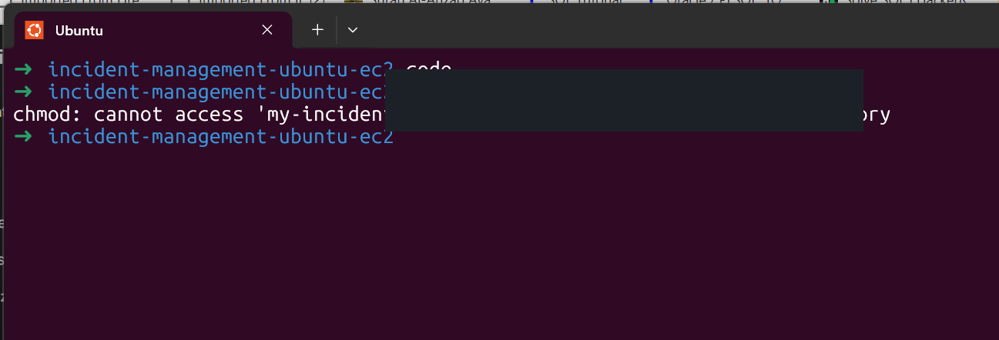</details>
<details><summary>2. Private key location</summary>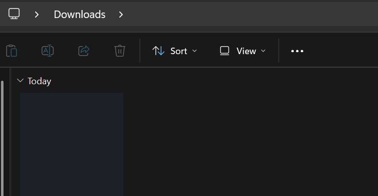</details>
<details><summary>3. SSH key path troubleshooting</summary>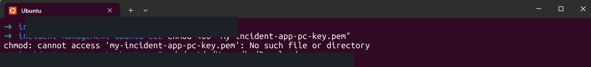</details>
<details><summary>4. Deployment health check</summary>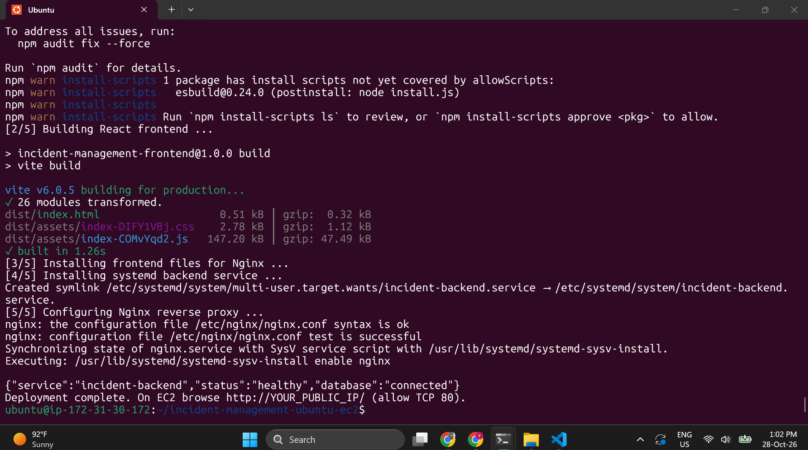</details>
<details><summary>5. EC2 instance running</summary>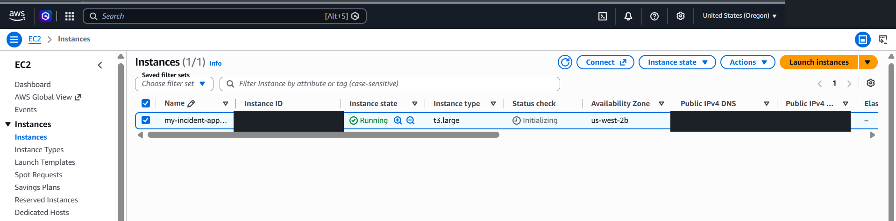</details>
<details><summary>6. EC2 instance address</summary>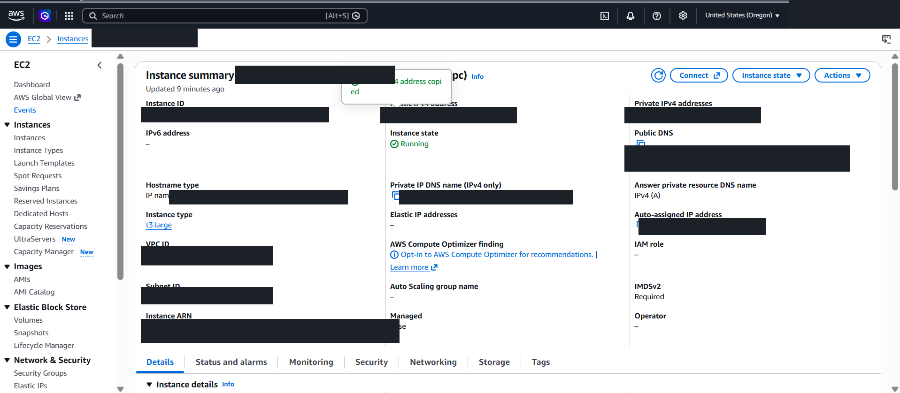</details>
<details><summary>7. Incident form</summary>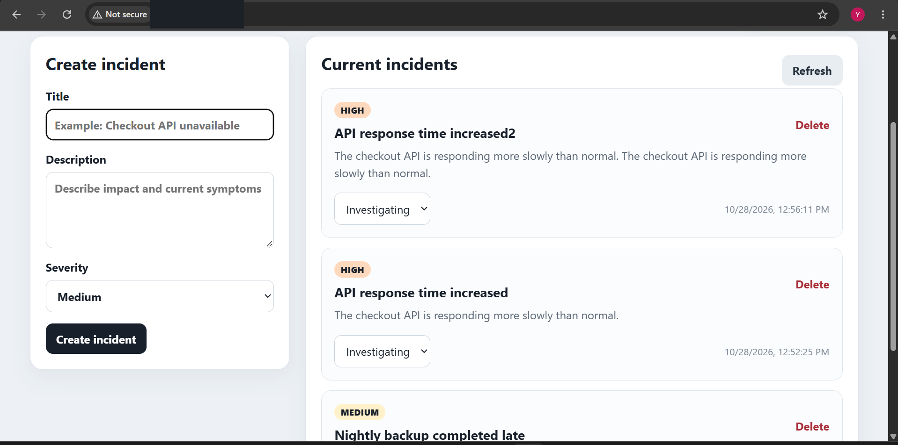</details>
<details><summary>8. Incident dashboard</summary>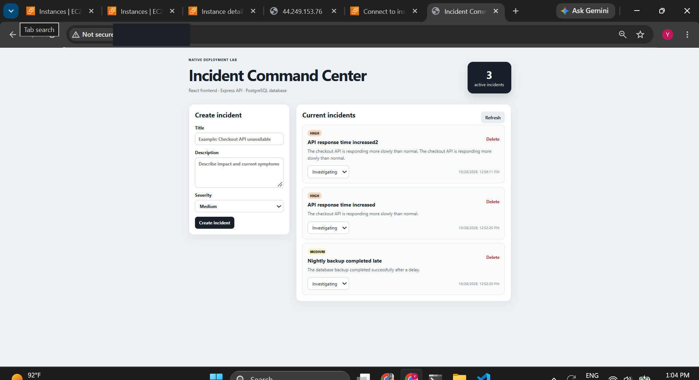</details>
<details><summary>9. AWS SSH instructions</summary>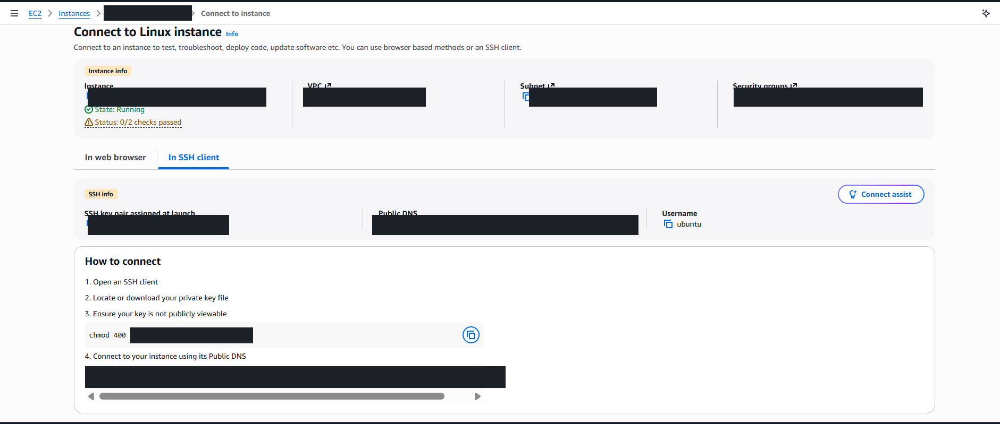</details>
<details><summary>10. SSH session</summary>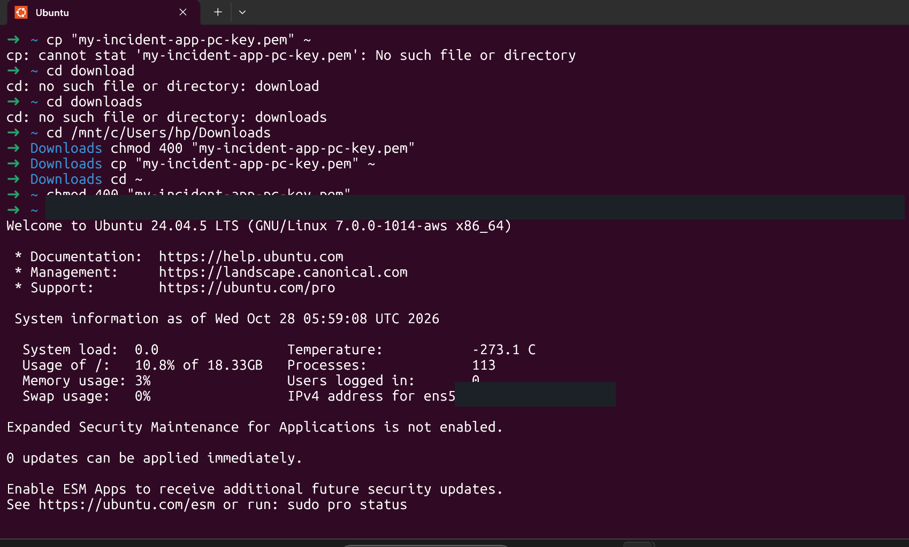</details>
<details><summary>11. Ubuntu package update</summary>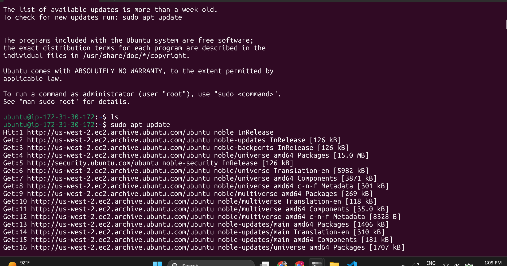</details>
<details><summary>12. Clone the repository</summary>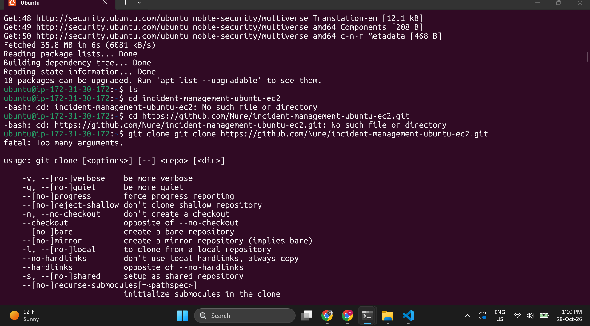</details>
<details><summary>13. Clone and start Node.js setup</summary>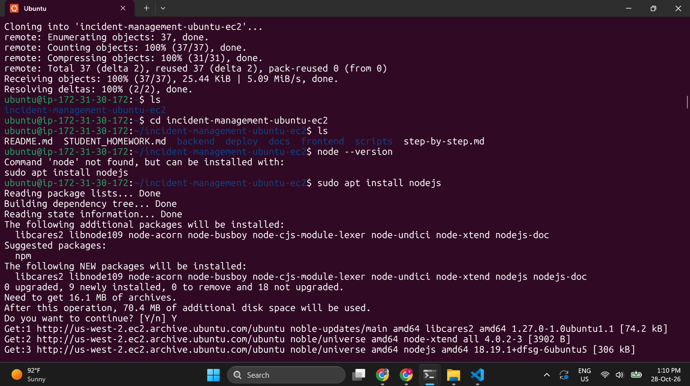</details>
<details><summary>14. Check Node.js version</summary>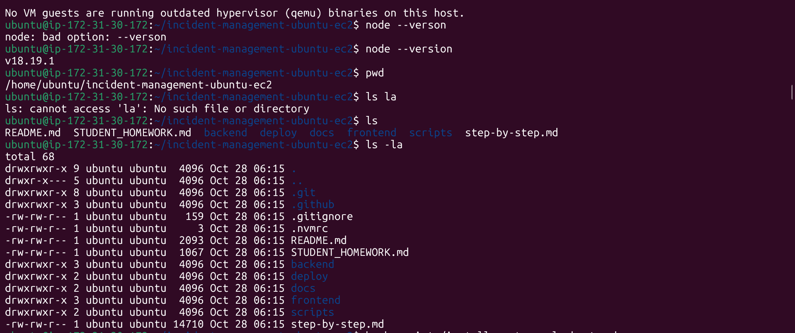</details>
<details><summary>15. Install PostgreSQL</summary>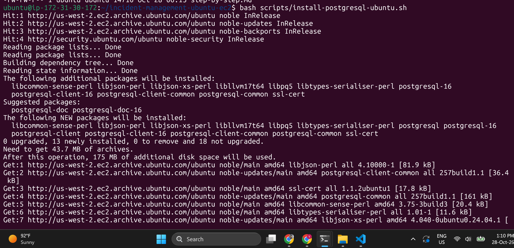</details>
<details><summary>16. Check PostgreSQL and install Nginx</summary>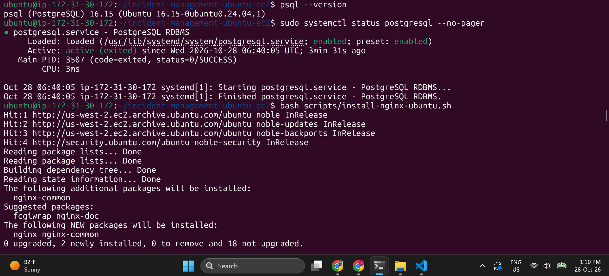</details>
<details><summary>17. Nginx service status</summary>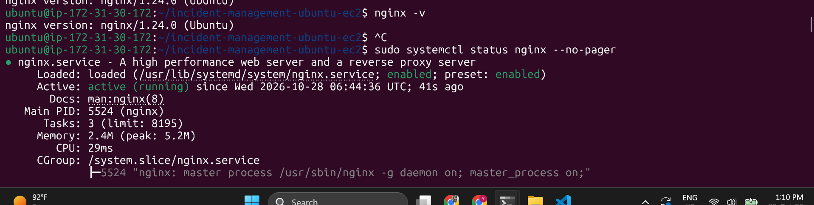</details>
<details><summary>18. Install base tools</summary>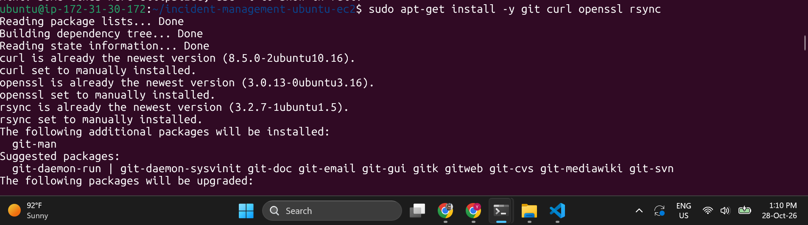</details>
<details><summary>19. Install Ubuntu prerequisites</summary>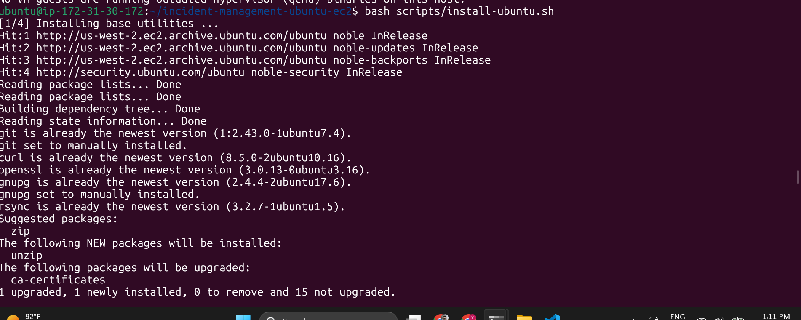</details>
<details><summary>20. Database setup</summary>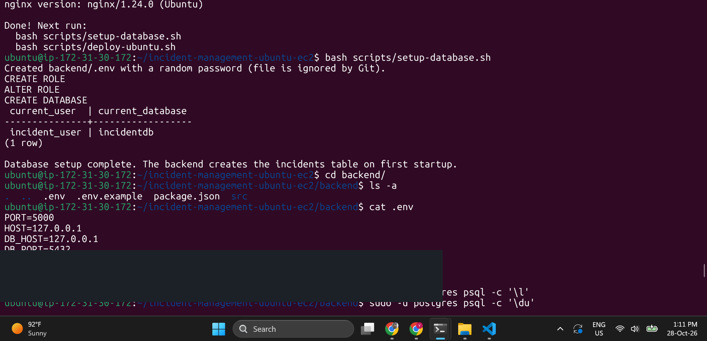</details>
<details><summary>21. Build and dependency audit</summary>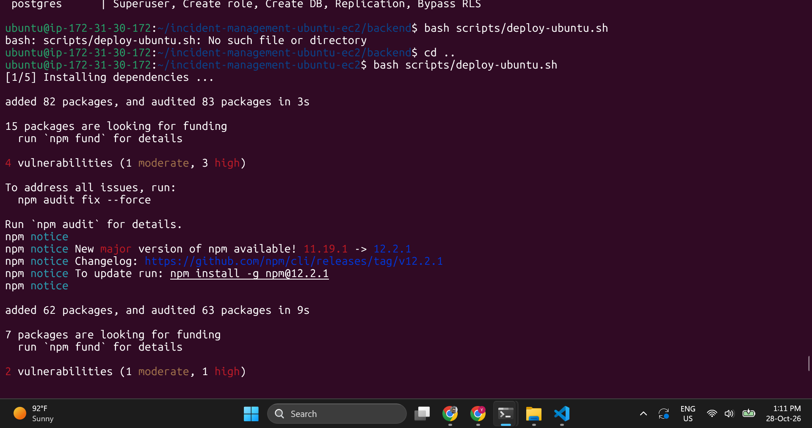</details>
<details><summary>22. Deployment complete</summary>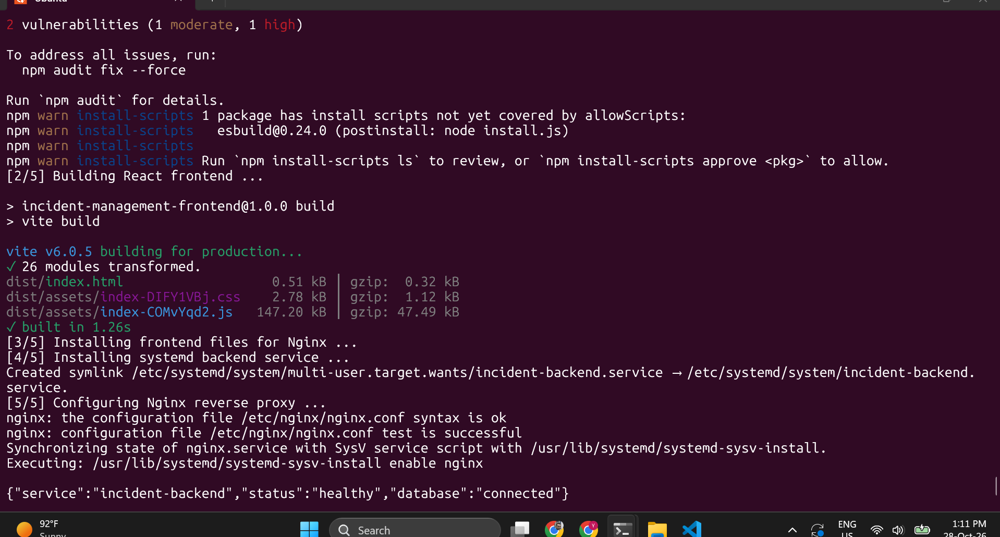</details>

</details>

Three course-platform screenshots in the supplied archive show class listings or a course player rather than project setup, so they are intentionally not copied into this public repository.

| File | Purpose |
|---|---|
| `step-by-step.md` | Student lab from start to finish |
| `frontend/` | React + Vite client |
| `backend/` | Node.js + Express + PostgreSQL REST API |
| `scripts/install-nodejs-ubuntu.sh` | Install Node.js 24 on Ubuntu 24.04 |
| `scripts/install-postgresql-ubuntu.sh` | Install PostgreSQL |
| `scripts/install-nginx-ubuntu.sh` | Install Nginx |
| `scripts/install-ubuntu.sh` | Install everything plus base utilities |
| `scripts/setup-database.sh` | Create database and local backend `.env` |
| `scripts/deploy-ubuntu.sh` | Build UI, install systemd service and Nginx site |
| `scripts/check-services.sh` | Display service and port diagnostics |
| `.github/workflows/deploy.yml` | Optional GitHub Actions homework deployment |
| `docs/GITHUB_ACTIONS.md` | Optional second-phase CI/CD walkthrough |

> Educational demo: app has no authentication and uses HTTP. Do not store sensitive incidents; do not expose Node port 5000 or PostgreSQL port 5432 publicly. Terminate demo resources when finished to avoid AWS charges.
